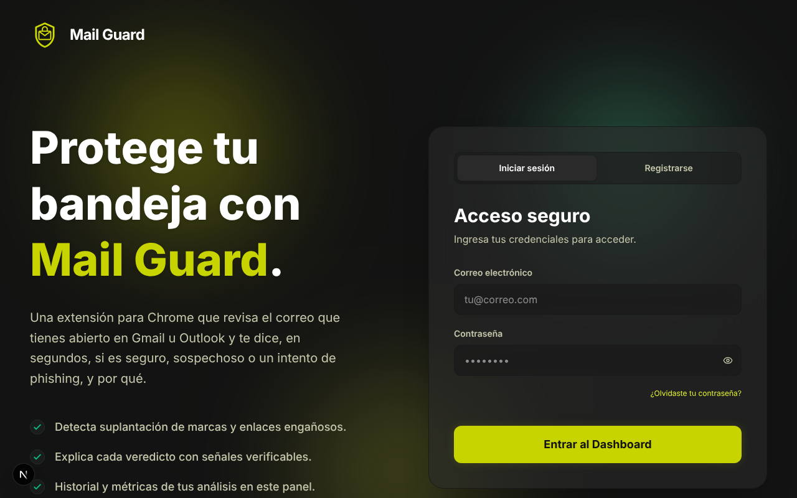
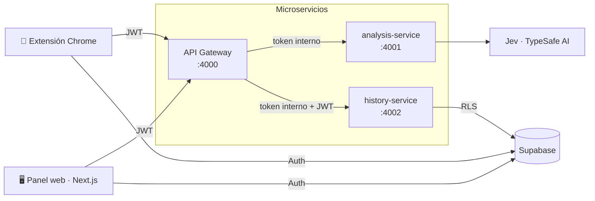

<div align="center">


# Mail Guard

**Detección de phishing explicable para Gmail y Outlook.**

Una extensión de Chrome que analiza el correo que tienes abierto y te dice, en segundos,
si es **seguro**, **sospechoso** o **peligroso**, y sobre todo, **por qué**.


</div>

---

## ¿Qué es Mail Guard?

El phishing sigue siendo la puerta de entrada más común a fraudes y robos de cuentas, y en
Colombia suplanta con frecuencia a bancos, billeteras digitales y entidades como la DIAN.
Los filtros de los proveedores de correo ayudan, pero cuando un mensaje pasa el filtro
el usuario queda solo frente a la pregunta: _¿puedo confiar en esto?_

**Mail Guard** responde esa pregunta justo donde surge: con el correo abierto.

1. Abres un correo en Gmail u Outlook y pulsas **Escanear correo**.
2. La extensión envía solo lo necesario: remitente, asunto, texto y enlaces (**nunca adjuntos**).
3. El backend combina **reglas verificables** con un **modelo de decisión** ([Jev](https://typesafe.ai) de TypeSafe AI).
4. Recibes un **nivel de confianza (0–100)**, un **veredicto**, las **señales** que lo justifican y un **consejo** concreto.



Con una cuenta, cada análisis se guarda en tu historial y puedes ver tus métricas en la
extensión o en el **panel web**.

### Características

|                               |                                                                                                                                     |
| ----------------------------- | ----------------------------------------------------------------------------------------------------------------------------------- |
| 🎯 **Veredicto explicable**   | Cada resultado muestra señales por remitente, contenido y enlaces, con la evidencia que las activó.                                 |
| 🧠 **IA para decisiones**     | Jev responde preguntas tipadas (opción, puntaje, sí/no) con probabilidades calibradas. Sin JSON frágil ni alucinaciones de formato. |
| 🛡️ **Defensa en profundidad** | Las reglas objetivas (dominios que imitan marcas, IPs, punycode, acortadores…) nunca quedan ocultas por un modelo optimista.        |
| 🔌 **Motor intercambiable**   | Jev, cualquier LLM compatible con OpenAI o reglas locales, con respaldo automático si el proveedor falla.                           |
| 📊 **Historial y métricas**   | Tendencia de confianza, volumen diario, distribución de veredictos y detalle de cada análisis.                                      |
| 🔒 **Privacidad por diseño**  | Permisos mínimos (`activeTab`), RLS en Postgres, claves solo en el servidor, deduplicación por huella SHA-256.                      |
| ⚡ **Rápido y económico**     | Caché por huella del correo: repetir un análisis no gasta IA ni cuota.                                                              |
| 🧪 **Funciona sin claves**    | En local todo arranca con el motor heurístico: ideal para demos y pruebas.                                                          |

---

## Arquitectura

Mail Guard es un monorepo con **2 clientes**, **3 microservicios** y **4 paquetes compartidos**.



| Microservicio        | Responsabilidad                                                                                 | Endpoints                                                                                          |
| -------------------- | ----------------------------------------------------------------------------------------------- | -------------------------------------------------------------------------------------------------- |
| **gateway**          | Único punto público: CORS, verificación de JWT, cuota diaria, orquestación y errores uniformes. | `POST /v1/scans` · `POST /v1/scans/sync` · `GET /v1/scans` · `GET /v1/me` · `GET /health/services` |
| **analysis-service** | Extrae evidencias, consulta el motor de decisión y compone el veredicto. Caché por huella.      | `POST /v1/analyze` · `GET /v1/engine`                                                              |
| **history-service**  | Historial, perfil y métricas por usuario sobre Supabase con RLS.                                | `POST /v1/scans` · `POST /v1/scans/sync` · `GET /v1/scans` · `GET /v1/me`                          |

**Patrones:** arquitectura **hexagonal** + casos de uso en los servicios, **MVVM** en la
extensión y Server Components + ViewModels en el panel. La justificación completa
(incluida la comparación MVC / MVP / MVVM) está en
[`docs/ARCHITECTURE.md`](docs/ARCHITECTURE.md), y los 11 casos de uso con sus flujos en
[`docs/USE_CASES.md`](docs/USE_CASES.md).

### Estructura del repositorio

```
mail-guard/
├── apps/
│   ├── extension-web/        # Extensión Chrome MV3 (React + Vite + CRXJS) · MVVM
│   └── extension-dashboard/  # Panel web (Next.js 16): landing, auth y métricas
├── services/
│   ├── gateway/              # API Gateway (Bun + Hono)
│   ├── analysis-service/     # Motor de análisis: reglas + Jev / LLM
│   └── history-service/      # Historial y métricas (Supabase + RLS)
├── packages/
│   ├── contracts/            # Schemas Zod y tipos compartidos (fuente única de verdad)
│   ├── api-client/           # Cliente tipado del gateway (extensión y panel)
│   ├── service-kit/          # Base común de los servicios: errores, logs, health, auth interna
│   ├── supabase/             # Casos de uso de autenticación
│   ├── tailwind-config/      # Tokens de diseño
│   └── typescript-config/    # Presets de TypeScript
├── supabase/migrations/      # Esquema SQL idempotente (tablas, RLS, triggers)
├── docs/                     # Arquitectura y casos de uso
├── Dockerfile                # Imagen única para los microservicios
└── docker-compose.yml
```

---

## Inicio rápido

**Requisitos:** [Bun](https://bun.sh) ≥ 1.2, Node.js ≥ 22 y Google Chrome.

```bash
bun install        # dependencias de todo el monorepo
bun run setup      # crea los .env a partir de los .env.example
bun run dev        # levanta gateway, análisis, historial, panel web y extensión
```

| Servicio         | URL                                                  |
| ---------------- | ---------------------------------------------------- |
| API Gateway      | http://localhost:4000 · estado en `/health/services` |
| analysis-service | http://localhost:4001                                |
| history-service  | http://localhost:4002                                |
| Panel web        | http://localhost:3000                                |

> Sin configurar nada, el análisis funciona con el **motor heurístico** y en **modo invitado**.
> Para cuentas, historial y métricas configura Supabase; para IA, agrega `TYPESAFE_API_KEY`.

### Cargar la extensión en Chrome

1. `cd apps/extension-web && bun run build`
2. Abre `chrome://extensions` y activa **Modo de desarrollador**.
3. **Cargar descomprimida** → selecciona `apps/extension-web/dist`.
4. Abre un correo en Gmail u Outlook, haz clic en el ícono de Mail Guard y pulsa **Escanear correo**.

Vuelve a compilar y recargar la extensión cada vez que cambies variables `VITE_*`.

### Probar el API directamente

```bash
curl -s http://localhost:4000/v1/scans \
  -H 'Content-Type: application/json' \
  -d '{"email":{"provider":"Gmail","sender":"alertas@bancolombla-seguridad.com",
       "senderName":"Bancolombia","subject":"URGENTE: tu cuenta será bloqueada",
       "bodyText":"Verifica tu cuenta e ingresa tu contraseña en las próximas 24 horas.",
       "links":["http://192.168.1.20/login"]}}'
```

Respuesta (resumida):

```json
{
  "scan": {
    "trustScore": 0,
    "verdict": "dangerous",
    "summary": "Este correo presenta señales claras de phishing o fraude. Hallazgos: Imita a Bancolombia; …",
    "signals": [
      {
        "key": "sender",
        "status": "fail",
        "value": "Imita a Bancolombia",
        "detail": "…"
      }
    ],
    "links": [
      {
        "url": "http://192.168.1.20/login",
        "status": "dangerous",
        "detail": "El enlace apunta a una IP…"
      }
    ],
    "model": "mail-guard-heuristics-v1"
  },
  "cached": false,
  "saved": false,
  "quota": { "limit": 5, "remaining": 4 }
}
```

### Con Docker

```bash
bun run setup                      # o crea los .env de services/* a mano
INTERNAL_SERVICE_TOKEN=un-secreto docker compose up --build
```

Solo el gateway se publica (`:4000`); los servicios internos quedan en la red de Docker.

---

## Configuración

### 1. Supabase (cuentas, historial y métricas)

1. Crea un proyecto en [supabase.com](https://supabase.com).
2. En **SQL Editor** ejecuta [`supabase/migrations/0001_mail_guard.sql`](supabase/migrations/0001_mail_guard.sql).
   Es idempotente: crea o actualiza tablas, políticas RLS, deduplicación y triggers de métricas.
3. En **Authentication → URL Configuration** agrega `http://localhost:3000/reset-password`
   (y la URL de producción) a las _Redirect URLs_.
4. Copia la URL del proyecto y la **publishable key** en los `.env`.

### 2. Jev (opcional, recomendado)

Solicita acceso en [typesafe.ai](https://typesafe.ai) y define `TYPESAFE_API_KEY` en
`services/analysis-service/.env`. Con `DECISION_ENGINE=auto` se usará automáticamente.

### Variables de entorno

<details>
<summary><b>services/gateway/.env</b></summary>

| Variable                                              | Descripción                                                                   | Por defecto                        |
| ----------------------------------------------------- | ----------------------------------------------------------------------------- | ---------------------------------- |
| `PORT`                                                | Puerto                                                                        | `4000`                             |
| `INTERNAL_SERVICE_TOKEN`                              | Secreto compartido con los servicios internos (**obligatorio en producción**) | `dev-internal-token` en desarrollo |
| `ANALYSIS_SERVICE_URL` / `HISTORY_SERVICE_URL`        | URLs internas                                                                 | `http://localhost:4001` / `4002`   |
| `SUPABASE_URL` / `SUPABASE_PUBLISHABLE_KEY`           | Para verificar el JWT del usuario                                             | — (todos anónimos)                 |
| `CORS_ORIGINS`                                        | Orígenes permitidos, separados por coma                                       | `*`                                |
| `SCAN_ANONYMOUS_LIMIT` / `SCAN_AUTHENTICATED_LIMIT`   | Análisis diarios                                                              | `5` / `100`                        |
| `UPSTASH_REDIS_REST_URL` / `UPSTASH_REDIS_REST_TOKEN` | Cuota distribuida                                                             | — (memoria)                        |

</details>

<details>
<summary><b>services/analysis-service/.env</b></summary>

| Variable                                              | Descripción                               | Por defecto       |
| ----------------------------------------------------- | ----------------------------------------- | ----------------- |
| `DECISION_ENGINE`                                     | `auto`, `jev`, `llm` o `heuristic`        | `auto`            |
| `TYPESAFE_API_KEY` / `TYPESAFE_MODEL`                 | Jev (TypeSafe AI)                         | — / `jev-latest`  |
| `AI_API_URL` / `AI_API_KEY` / `AI_MODEL`              | LLM compatible con OpenAI (p. ej. Gemini) | —                 |
| `UPSTASH_REDIS_REST_URL` / `UPSTASH_REDIS_REST_TOKEN` | Caché distribuida                         | — (memoria)       |
| `CACHE_TTL_SECONDS`                                   | Vigencia del caché                        | `604800` (7 días) |

</details>

<details>
<summary><b>services/history-service/.env</b></summary>

| Variable                                    | Descripción                                                     |
| ------------------------------------------- | --------------------------------------------------------------- |
| `SUPABASE_URL` / `SUPABASE_PUBLISHABLE_KEY` | Proyecto de Supabase. Sin ellas, los endpoints responden `503`. |

</details>

<details>
<summary><b>apps/extension-web/.env</b> (público, se incrusta en el bundle)</summary>

| Variable                                              | Descripción                                                      |
| ----------------------------------------------------- | ---------------------------------------------------------------- |
| `VITE_API_GATEWAY_URL`                                | URL del gateway (también se agrega a `host_permissions`)         |
| `VITE_DASHBOARD_URL`                                  | URL del panel web (recuperación de contraseña y enlace al panel) |
| `VITE_SUPABASE_URL` / `VITE_SUPABASE_PUBLISHABLE_KEY` | Supabase Auth                                                    |

</details>

<details>
<summary><b>apps/extension-dashboard/.env.local</b></summary>

| Variable                                                            | Descripción                     |
| ------------------------------------------------------------------- | ------------------------------- |
| `NEXT_PUBLIC_SUPABASE_URL` / `NEXT_PUBLIC_SUPABASE_PUBLISHABLE_KEY` | Supabase Auth                   |
| `API_GATEWAY_URL`                                                   | URL del gateway (solo servidor) |

</details>

> Las variables `VITE_*` y `NEXT_PUBLIC_*` **no son secretas**. `TYPESAFE_API_KEY`, `AI_API_KEY`,
> `UPSTASH_REDIS_REST_TOKEN` e `INTERNAL_SERVICE_TOKEN` **sí lo son**: nunca las pongas en un cliente.

---

## Calidad

```bash
bun run test          # 39 pruebas unitarias y de integración HTTP (bun test)
bun run check-types   # TypeScript estricto en los 9 proyectos
bun run build         # build de la extensión y del panel
```

Las pruebas cubren las heurísticas (dominios que imitan marcas, enlaces peligrosos), la
combinación modelo + reglas, el adaptador de Jev (con un `fetch` simulado), el respaldo ante
fallos, la caché, la cuota, la deduplicación del historial y las rutas de cada servicio.

---

## Despliegue

| Componente     | Recomendación                                                                                                                                                  |
| -------------- | -------------------------------------------------------------------------------------------------------------------------------------------------------------- |
| Panel web      | **Vercel** con _Root Directory_ `apps/extension-dashboard`. Variables: las de `.env.local`.                                                                    |
| Microservicios | Cualquier plataforma de contenedores (**Render**, **Railway**, **Fly.io**) usando el `Dockerfile` con `--build-arg SERVICE=<servicio>`. Expón solo el gateway. |
| Cuota y caché  | **Upstash Redis** cuando haya más de una instancia.                                                                                                            |
| Extensión      | `bun run build` con las URLs de producción y sube `apps/extension-web/release/*.zip` a la Chrome Web Store.                                                    |

Antes de publicar: define `CORS_ORIGINS=chrome-extension://<ID>,https://<tu-panel>` y un
`INTERNAL_SERVICE_TOKEN` largo y aleatorio en los tres servicios.

---

## Seguridad y privacidad

- **Datos mínimos:** solo remitente, asunto, texto visible y enlaces del correo abierto.
- **Permisos mínimos:** `activeTab` y `scripting`; sin `<all_urls>`.
- **Aislamiento por usuario:** el historial se consulta con el JWT del usuario y RLS de Postgres.
- **Servicios internos protegidos** por token compartido (comparación en tiempo constante).
- **Validación en cada frontera** con los mismos schemas Zod en clientes y servidores.
- **Sin afirmaciones inventadas:** el sistema no declara SPF/DKIM/DMARC porque no recibe encabezados.

## Hoja de ruta

- [ ] Leer encabezados de autenticación (SPF, DKIM, DMARC) desde la vista «mostrar original».
- [ ] Reputación de dominios y URLs (Google Safe Browsing / VirusTotal) como nuevo adaptador.
- [ ] Análisis automático al abrir un correo (opt-in).
- [ ] Reporte de falsos positivos para mejorar las reglas.

---

<div align="center">

Proyecto académico · **UTS**

</div>
