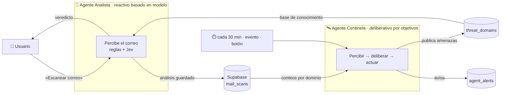

# Agentes inteligentes en Mail Guard

Mail Guard tiene **dos agentes** que hacen tareas distintas y además **se comunican**: el
Centinela aprende de los análisis de la comunidad y el Analista usa ese conocimiento en cada
correo nuevo.

## 1. Agente Analista

**Tarea:** analizar el correo abierto en Gmail u Outlook y decir si es seguro, sospechoso o
peligroso, explicando por qué.

**Clasificación: reactivo basado en modelo.**

- _Reactivo:_ responde a lo que percibe con reglas condición → acción. Por ejemplo: un dominio
  que imita a una marca da la señal «falla», y un enlace a una IP da «peligroso».
- _Basado en modelo:_ no solo mira el estímulo. Mantiene un **modelo interno del mundo**:
  marcas y sus dominios oficiales, palabras de urgencia, acortadores, extensiones de riesgo y,
  sobre todo, **las amenazas que publica el Centinela**. Por eso puede marcar como peligroso un
  correo que por sí solo parece inofensivo.
- No planifica a futuro ni tiene metas propias: por eso no es deliberativo.

**Modo: semiautomático.** Actúa cuando el usuario pulsa **Escanear correo**.

| PEAS            | Analista                                                                                             |
| --------------- | ---------------------------------------------------------------------------------------------------- |
| **Rendimiento** | Veredictos correctos y explicables, en segundos, sin exponer datos del usuario.                      |
| **Entorno**     | El correo abierto (Gmail/Outlook) y la base de conocimiento del Centinela.                           |
| **Actuadores**  | Veredicto, puntaje 0–100, señales por remitente/contenido/enlaces, consejo e insignia en la pestaña. |
| **Sensores**    | Remitente, nombre visible, asunto, texto y enlaces del correo (nunca adjuntos).                      |

**Código:** `services/analysis-service/src/application/analyze-email.ts` (ciclo),
`src/domain/evidence.ts` y `src/domain/scoring.ts` (reglas),
`src/domain/threat-intel.ts` (uso del conocimiento del Centinela).

## 2. Agente Centinela

**Tarea:** vigilar los análisis de **todos** los usuarios, detectar campañas de phishing
activas, publicarlas en la base de conocimiento y avisar a quienes recibieron esos correos.

**Clasificación: deliberativo basado en objetivos, con función de utilidad.**

- **Objetivos explícitos:**
  - O1: detectar campañas activas.
  - O2: avisar a los usuarios expuestos.
  - O3: mantener vigente la base de conocimiento.
- **Creencias:** las amenazas que ya conoce (`threat_domains`).
- **Deliberación:** para cada dominio compara lo observado con lo que cree y elige una acción:

  | Decisión      | Cuándo                                                                         | Acciones                       |
  | ------------- | ------------------------------------------------------------------------------ | ------------------------------ |
  | **Publicar**  | ≥ 2 reportes peligrosos (o ≥ 3 entre peligrosos y sospechosos) y no lo conocía | Agrega la amenaza y avisa      |
  | **Escalar**   | Lo conocía como sospechoso y ahora alcanza el nivel peligroso                  | Actualiza la amenaza y avisa   |
  | **Refrescar** | Lo conoce y llegaron reportes nuevos                                           | Actualiza los conteos          |
  | **Retirar**   | 30 días sin reportes                                                           | Lo desactiva                   |
  | **Descartar** | Proveedor masivo (gmail.com, outlook.com…) o reputación mixta                  | Ninguna (queda la explicación) |

- **Utilidad:** `prioridad = 3·peligrosos + sospechosos + 2·usuarios − 2·seguros`. Si hay más
  trabajo del que cabe en un ciclo (25 acciones), se atiende primero lo de mayor prioridad.
- **No se engaña a sí mismo:** los veredictos que ya incluyen su conocimiento
  (`… + centinela`) no cuentan como reportes nuevos.

**Modo: automático** (y también semiautomático):

- **Periódico:** un ciclo cada `SENTINEL_INTERVAL_MINUTES` (30 por defecto) y otro al arrancar el
  servicio.
- **Por evento:** cuando se guarda un análisis sospechoso o peligroso, programa un ciclo
  (agrupando los que lleguen en los siguientes 45 s).
- **Manual:** botón **Ejecutar Centinela** en la página **Agentes** del panel.

| PEAS            | Centinela                                                                                       |
| --------------- | ----------------------------------------------------------------------------------------------- |
| **Rendimiento** | Campañas detectadas pronto, usuarios expuestos avisados, cero bloqueos de proveedores masivos.  |
| **Entorno**     | Análisis agregados de todos los usuarios de los últimos 30 días (solo dominio y conteos).       |
| **Actuadores**  | Publicar, escalar, refrescar o retirar amenazas; crear alertas para los usuarios expuestos.     |
| **Sensores**    | Por dominio: reportes peligrosos, sospechosos y seguros, usuarios distintos y última actividad. |

**Código:** `services/history-service/src/agents/sentinel/`:

- `policy.ts`: deliberación pura y probada.
- `sentinel.ts`: el ciclo completo.
- `scheduler.ts`: la autonomía.

El acceso a datos está en `src/infrastructure/supabase.agents.ts`. El esquema es
`supabase/migrations/0006_agentes.sql`.

### Privacidad

El Centinela **nunca ve el contenido** de los correos. Su sensor
(`sentinel_observations`) devuelve solo dominio y conteos, y solo el rol `service_role` puede
ejecutarlo. Las alertas se crean con `sentinel_alert_exposed_users`, sin que el agente conozca
quiénes son los usuarios. Cada usuario ve **solo sus alertas** (RLS). Borrar el historial
también borra sus alertas.

## 3. Cómo se comunican

1. El usuario escanea, el Analista responde y el análisis se guarda en `mail_scans`.
2. El Centinela percibe los conteos por dominio, delibera y publica en `threat_domains`.
3. En cada análisis nuevo, el gateway trae la base de conocimiento del history-service
   (`GET /v1/agents/threats`, en caché 60 s) y se la entrega al Analista
   (`POST /v1/analyze { email, threats }`).
4. Si el remitente o un enlace están en una campaña, el Analista:
   - pone la señal **«Reportado por el agente Centinela»**;
   - limita el puntaje a 15 (peligroso) o a 45 (sospechoso);
   - agrega `+ centinela` al modelo.

## 4. Puesta en marcha

1. Supabase → **SQL Editor** → ejecuta `supabase/migrations/0006_agentes.sql`.
2. Supabase → **Settings → API Keys** → copia la **secret key**.
3. Render → `mail-guard-history` → **Environment** → agrega `SUPABASE_SECRET_KEY` (y, si quieres,
   `SENTINEL_INTERVAL_MINUTES`). Guarda y redespliega.
4. Panel → **Agentes**: el Centinela debe aparecer como «Activo».

> En el plan free de Render el servicio se duerme sin tráfico. Mientras duerme no corre el ciclo
> periódico, pero tampoco llegan análisis nuevos. Al despertar ejecuta un ciclo en unos 20 s.

## 5. Guion de demo (5 minutos)

1. Panel → **Agentes**: presenta ambos agentes (clasificación, modo y PEAS).
2. Con la extensión, escanea **2 o 3 correos de phishing del mismo dominio falso**. Sirven
   cuentas distintas o correos distintos.
3. Pulsa **Ejecutar Centinela** (semiautomático) o espera unos 45 s para el disparo por evento
   (automático).
4. Muestra el **último ciclo**: percepción (conteos), deliberación (decisión y motivo) y acción
   (amenaza publicada, usuarios avisados). Aparecen **Tus alertas** y la **Base de conocimiento**.
5. Escanea un correo **tranquilo** del mismo dominio (sin urgencia ni enlaces raros). El Analista
   lo marca **peligroso** con la señal «Reportado por el agente Centinela»: los agentes están
   conectados.

## 6. Pruebas

| Prueba                                                | Qué verifica                                                           |
| ----------------------------------------------------- | ---------------------------------------------------------------------- |
| `services/history-service/test/sentinel.test.ts`      | Cada decisión, la utilidad, los límites, el ciclo y la concurrencia.   |
| `services/analysis-service/test/threat-intel.test.ts` | El Analista aplica el conocimiento, también sobre resultados en caché. |
| `services/gateway/test/api/agents.api.test.ts`        | De punta a punta con los 3 microservicios: campaña, alerta y efecto.   |
