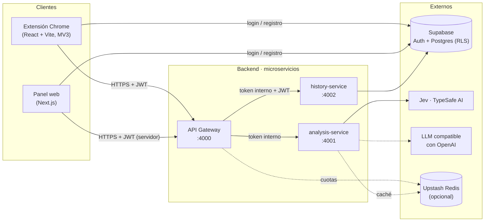
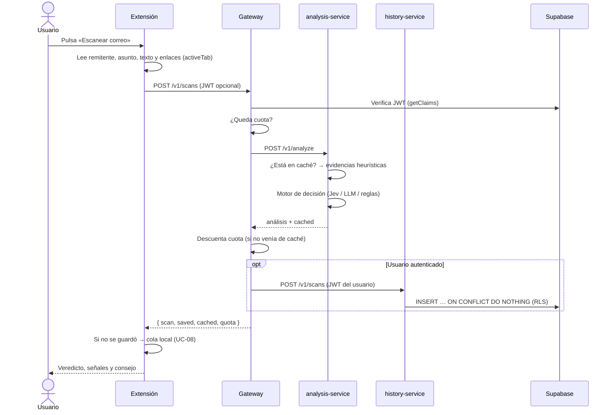

# Arquitectura de Mail Guard

Este documento explica **qué** se construyó, **por qué** se eligió cada patrón y
**cómo** encajan las piezas. Está pensado para la sustentación del proyecto.

## 1. Vista general



| Pieza                | Responsabilidad única                                                                                                                        | Tecnología                               |
| -------------------- | -------------------------------------------------------------------------------------------------------------------------------------------- | ---------------------------------------- |
| **API Gateway**      | Punto de entrada: CORS, verificación del JWT, cuota diaria, orquestación y traducción de errores. No contiene reglas de negocio de análisis. | Bun + Hono                               |
| **analysis-service** | Decidir si un correo es seguro: extrae evidencias, consulta el motor (Jev / LLM / reglas) y compone el veredicto. No sabe de usuarios.       | Bun + Hono + `@typesafe-ai/sdk`          |
| **history-service**  | Persistir análisis, perfil y métricas por usuario. No sabe cómo se analiza un correo.                                                        | Bun + Hono + Supabase                    |
| **Extensión**        | Leer el correo abierto y mostrar el resultado.                                                                                               | React 19 + Vite + CRXJS                  |
| **Panel web**        | Landing, autenticación, recuperación de contraseña y métricas históricas.                                                                    | Next.js 16 (App Router) + Apache ECharts |

## 2. ¿Por qué microservicios (y por qué exactamente estos tres)?

El requisito académico pide **mínimo 3 microservicios**. Para que no sean una
división artificial, cada servicio corresponde a un **contexto delimitado**
(DDD) con datos, ritmo de cambio y necesidades de escalado distintos:

| Criterio                     | Gateway                  | Análisis                                 | Historial                                     |
| ---------------------------- | ------------------------ | ---------------------------------------- | --------------------------------------------- |
| Datos propios                | Contadores de cuota      | Caché de análisis                        | `mail_scans`, `profiles`, `profile_analytics` |
| Cambia cuando…               | cambian reglas de acceso | cambia el modelo de IA o las heurísticas | cambia el esquema de datos                    |
| Escala por…                  | tráfico total            | costo/latencia de IA                     | lecturas del panel                            |
| Falla sin tumbar a los demás | —                        | se responde con el respaldo heurístico   | el análisis sigue; se guarda en cola local    |

**Honestidad técnica:** para un equipo de una persona, un _monolito modular_
sería más simple de operar. La arquitectura se diseñó para que el costo sea
bajo: los tres servicios comparten contratos tipados (`@mail-guard/contracts`)
y una base común (`@mail-guard/service-kit`), arrancan con un solo comando y
funcionan sin claves externas en desarrollo.

### Comunicación

- **Síncrona, HTTP/JSON**, validada en ambos extremos con Zod.
- **Solo el gateway es público.** Los servicios internos exigen la cabecera
  `x-internal-token` (comparación en tiempo constante) y en Docker ni siquiera
  publican puertos.
- **Trazabilidad:** el gateway genera `x-request-id` y lo propaga; todos los
  servicios escriben logs JSON con ese id.
- **Errores uniformes:** siempre `{ "error": "mensaje para el usuario" }`. Los
  4xx internos se propagan; los 5xx se exponen como 502 sin filtrar detalles.

### Secuencia del caso principal (UC-01 + UC-07)



## 3. Patrones por capa: ¿MVC, MVP o MVVM?

Ninguno de los tres aplica igual a todo el sistema; se eligió **uno por capa**:

| Capa                | Patrón                                                                                     | Por qué                                                                                                                                                                                                                                                            |
| ------------------- | ------------------------------------------------------------------------------------------ | ------------------------------------------------------------------------------------------------------------------------------------------------------------------------------------------------------------------------------------------------------------------ |
| Microservicios      | **Arquitectura hexagonal** (puertos y adaptadores) + **casos de uso** (Clean Architecture) | El dominio (detectar phishing) no depende de Hono, Supabase ni del proveedor de IA. Cambiar Jev por otro modelo es escribir un adaptador.                                                                                                                          |
| Extensión (React)   | **MVVM**                                                                                   | React ya es el _View_. Los hooks `useScanViewModel` y `useAccountViewModel` son _ViewModels_: exponen estado listo para pintar y comandos (`scan()`, `signIn()`), y las vistas solo se enlazan a ellos. `model/` encapsula Chrome, el gateway y el almacenamiento. |
| Panel web (Next.js) | **MVVM ligero + Server Components**                                                        | Los _Server Components_ cargan datos (`dashboard.data.ts`) y las vistas cliente reciben props; los hooks de formularios (`useAuthForm`) actúan como ViewModels.                                                                                                    |

**¿Por qué no MVC?** En MVC el _Controller_ recibe la entrada y decide qué vista
mostrar; en React la entrada llega directamente a los componentes y el
renderizado es declarativo, así que un controlador separado termina siendo
código ceremonial. **¿Por qué no MVP?** El _Presenter_ manipula la vista a través
de una interfaz imperativa (`view.showError()`); React invierte eso con estado
reactivo, que es justamente lo que modela MVVM. En el backend, el equivalente
moderno de MVC (controlador → servicio → repositorio) existe, pero organizado
hexagonalmente: las rutas Hono son adaptadores de entrada y no contienen lógica.

### Estructura hexagonal de cada servicio

```
src/
├── domain/          # Reglas puras, sin dependencias (evidencias, puntajes, narrativa)
├── application/     # Casos de uso + puertos (interfaces)
├── infrastructure/  # Adaptadores: Jev, LLM, Redis, Supabase…
├── http/            # Adaptador de entrada (rutas Hono)
├── config.ts        # Variables de entorno validadas con Zod
└── index.ts         # Composition root: único lugar que conoce las implementaciones
```

### Estructura MVVM de la extensión

```
src/
├── app/                 # Shell: App, cabecera, navegación, estilos
├── config/env.ts        # Variables públicas
├── lib/                 # Clientes: Supabase Auth, API Gateway, storage tipado
├── shared/icons/        # Iconos SVG
└── features/
    ├── scan/
    │   ├── model/       # Lectura del DOM, cola offline, persistencia local
    │   ├── useScanViewModel.ts
    │   └── views/       # ScanView, AnalysisResultView, SignalCard, TrustScoreRing
    └── account/
        ├── useAccountViewModel.ts
        └── views/       # AccountView, AuthForm, ProfileView, gráficos
```

### Componentes compartidos (`@mail-guard/ui`)

La extensión y el panel usan los mismos `Button`, `TextField`, `VerdictBadge`,
`TrustRing`, `Skeleton` y el hook `useZodForm`, que valida con los mismos
schemas Zod del backend y muestra el error bajo cada campo. `cn()` (clsx +
tailwind-merge) permite sobrescribir estilos sin conflictos. Tailwind v4 los
incluye con `@source` en cada `globals.css`.

### Gráficos (Apache ECharts)

El panel usa [Apache ECharts](https://echarts.apache.org) 6 con registro modular
(solo línea, barras, dona, mapa de calor y radial), renderizado SVG y carga
diferida: la librería se descarga después de pintar la página. Un único
componente `<EChart>` se encarga del tamaño, de las animaciones entre filtros,
de «reducir movimiento» y de la descripción accesible (`aria`). El tema propio
(`charts/theme.ts`) mantiene la identidad visual en todos los gráficos.

## 4. Motor de decisión: por qué Jev

Detectar phishing **es una decisión acotada**: el resultado es una de pocas
categorías (seguro / sospechoso / peligroso), un puntaje y varias preguntas
sí/no. Para ese tipo de tarea, [Jev](https://typesafe.ai) (TypeSafe AI) encaja
mejor que un LLM conversacional:

|                           | LLM de chat                                                          | Jev                                                       |
| ------------------------- | -------------------------------------------------------------------- | --------------------------------------------------------- |
| Salida                    | Texto libre que hay que pedir «en JSON» y luego parsear y normalizar | Respuestas **tipadas**: `choice`, `score`, `noul` (sí/no) |
| Incertidumbre             | No la expresa de forma fiable                                        | **Probabilidades calibradas** y confianza por respuesta   |
| Latencia y costo          | Altos para respuestas cortas                                         | Diseñado para decisiones rápidas y baratas                |
| Riesgo de alucinar campos | Alto (el código anterior tenía ~150 líneas solo para normalizar)     | Inexistente: las opciones las define el programador       |

Una sola llamada a `client.systemOne()` responde:

- `verdict` → `choice` entre _safe / suspicious / dangerous_.
- `trust` → `score` sobre una rúbrica de 5 niveles → `trustScore` 0–100.
- `impersonation`, `pressure`, `sensitiveRequest` → `noul` (probabilidad de «sí»).
- `link_0 … link_9` → `choice` por cada enlace.

Si la confianza del veredicto es menor a 0,5, el veredicto se deriva del
puntaje combinado en lugar de aceptar una elección dudosa.

### Defensa en profundidad

El motor nunca decide solo. `analysis-service` siempre calcula primero
**evidencias objetivas** (dominios que imitan marcas, IPs, punycode,
acortadores, lenguaje de urgencia, solicitud de credenciales) y luego:

1. Mezcla el puntaje: `70 % modelo + 30 % reglas`.
2. Por cada señal se queda con **la más grave** entre modelo y reglas: una
   evidencia objetiva no puede ser «tapada» por un modelo optimista.
3. Si el proveedor falla o no hay clave, responde con el **respaldo
   heurístico** (marcado como tal en `model`) en vez de devolver error.

`DECISION_ENGINE=auto` elige Jev si hay `TYPESAFE_API_KEY`, luego un LLM
compatible con OpenAI, y por último las reglas locales.

## 5. Seguridad

- La extensión solo pide `activeTab` + `scripting` (se eliminaron `tabs`,
  `contentSettings` y `sidePanel`, que no se usaban).
- Solo se envían remitente, asunto, texto visible y enlaces. Nunca adjuntos.
- Las claves de IA y Redis viven únicamente en `analysis-service` / `gateway`.
- `history-service` usa el **JWT del usuario**, no una clave de servicio:
  Postgres aplica RLS y un error de filtro no puede exponer datos ajenos. (La
  versión anterior consultaba con Prisma por conexión directa, saltándose RLS.)
- Cuota diaria por usuario o por IP; los resultados en caché no la consumen.
- Límite de 512 KB por petición y validación Zod en cada frontera.

## 6. Decisiones descartadas

| Alternativa                                  | Motivo                                                                                          |
| -------------------------------------------- | ----------------------------------------------------------------------------------------------- |
| Mantener Prisma en el panel web              | Conexión directa que saltaba RLS y duplicaba el acceso a datos del historial.                   |
| Mensajería asíncrona (colas) entre servicios | El flujo es petición-respuesta de pocos segundos; una cola añade infraestructura sin beneficio. |
| Un servicio de autenticación propio          | Supabase Auth ya cubre registro, sesiones y recuperación; duplicarlo es riesgo sin valor.       |
| Ejecutar Jev desde la extensión              | Expondría la API key en el bundle. Siempre del lado del servidor.                               |
