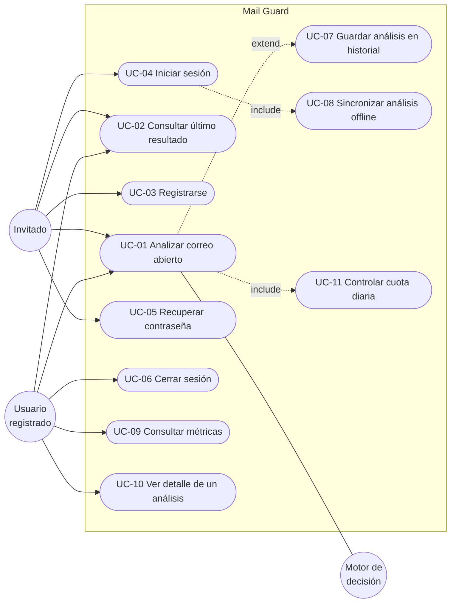

# Casos de uso de Mail Guard

## Actores

| Actor                  | Descripción                                                                     |
| ---------------------- | ------------------------------------------------------------------------------- |
| **Invitado**           | Usa la extensión sin cuenta. Puede analizar correos con una cuota diaria menor. |
| **Usuario registrado** | Tiene cuenta en Supabase. Su historial y métricas se guardan.                   |
| **Sistema**            | Procesos automáticos: cuotas, caché, sincronización.                            |
| **Motor de decisión**  | Jev (TypeSafe AI), un LLM compatible con OpenAI o las reglas locales.           |

## Diagrama

## Especificaciones

### UC-01 · Analizar correo abierto

- **Actores:** Invitado, Usuario registrado, Motor de decisión.
- **Precondición:** Hay un correo abierto en Gmail u Outlook en la pestaña activa.
- **Flujo principal:**
  1. El usuario abre la extensión y pulsa **Escanear correo**.
  2. La extensión lee remitente, nombre visible, asunto, texto y enlaces.
  3. El gateway verifica la cuota (UC-11) y pide el análisis.
  4. `analysis-service` busca el correo en caché por su huella SHA-256.
  5. Si no está, extrae evidencias, consulta al motor y combina el resultado.
  6. La extensión muestra puntaje, veredicto, señales, enlaces con alertas y un consejo.
- **Flujos alternos:**
  - 1a. La pestaña no es Gmail/Outlook → botón deshabilitado y aviso «Sitio no compatible».
  - 2a. Es la bandeja y no un correo → «Abre un correo para analizarlo».
  - 3a. Sin cuota → 429 con mensaje que invita a iniciar sesión.
  - 5a. El motor falla → resultado del respaldo heurístico.
- **Postcondición:** Si hay sesión se ejecuta UC-07; si no, el análisis queda en cola local.
- **Implementación:** `features/scan/useScanViewModel.ts` → `POST /v1/scans` → `createScanEmail` (gateway) → `createAnalyzeEmail` (analysis-service).

### UC-02 · Consultar último resultado

- Al reabrir el popup se muestra el último análisis (persistido localmente) hasta que el usuario pulse «volver».

### UC-03 · Registrarse

- **Flujo:** nombre, correo, contraseña y confirmación → validación Zod compartida → Supabase Auth. Si el proyecto exige confirmación por correo, se informa al usuario.
- **Postcondición:** el trigger SQL crea el perfil.

### UC-04 · Iniciar sesión

- **Flujo:** correo y contraseña → Supabase Auth → se ejecuta UC-08 → se cargan métricas (UC-09).
- **Disponible en:** extensión y panel web.

### UC-05 · Recuperar contraseña

- **Flujo:** el usuario pide el enlace → Supabase envía un correo → la página `/reset-password` del panel valida el enlace y guarda la nueva contraseña.

### UC-06 · Cerrar sesión

- Limpia la sesión de Supabase y los datos de cuenta mostrados.

### UC-07 · Guardar análisis en historial

- **Actor:** Sistema (disparado por UC-01 con sesión).
- **Regla:** un mismo correo (misma huella) se guarda una sola vez por usuario (`UNIQUE (profile_id, email_hash)`).
- **Postcondición:** el trigger `refresh_profile_analytics` actualiza las métricas agregadas.

### UC-08 · Sincronizar análisis offline

- **Actor:** Sistema (al iniciar sesión o refrescar la cuenta).
- **Flujo:** la extensión sube hasta 25 análisis de la cola local a `POST /v1/scans/sync`; se deduplican por huella y se vacía la cola.

### UC-09 · Consultar métricas

- **Flujo:** `GET /v1/me` (perfil + métricas) y `GET /v1/scans` (historial). Si la tabla agregada no existe, `history-service` calcula las métricas a partir de los análisis.
- **Vistas:** pestaña _Cuenta_ de la extensión (resumen) y `/dashboard` del panel (gráficos de tendencia, volumen diario y distribución).

### UC-10 · Ver detalle de un análisis

- En el panel, al seleccionar una fila se abre un modal con resumen, consejo, señales, enlaces (no clicables por seguridad) y la huella del correo.

### UC-11 · Controlar cuota diaria

- **Regla:** ventana deslizante de 24 h: 5 análisis para invitados (por IP) y 100 para usuarios (por id). Configurable.
- Un resultado servido desde caché **no** consume cuota (no gasta IA).
- La respuesta incluye `quota.remaining` y la extensión lo muestra.
